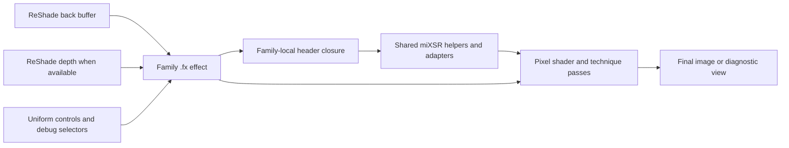

# Occult Box API 0.1.0

Occult Box API 0.1.0 begins a versioned description of the interfaces already
present in the Occult Box ReShade FX source. It documents two surfaces:

1. the **effect interface** exposed to ReShade users through techniques,
   uniforms, defaults, labels, tooltips, and diagnostics;
2. the **include interface** exposed to shader authors through family-local
   `.fxh` declarations and include relationships.

> **Status: documentation draft.** The extracted surface is public and
> inspectable, but this directory does not yet promise that every visible
> helper is a stable consumer API. It is not a binary ABI. The source has not
> been clean-compiled as one complete public package during this documentation
> pass, and live visual acceptance remains pending.

## Documentation map

- [Effect interface reference](EFFECTS.md) — all loadable techniques and their
  source-declared uniform controls.
- [Include surface](INCLUDES.md) — all headers, compatibility classes, hashes,
  and the explicitly named loop-safety API candidate.
- [Machine-readable symbol index](SYMBOLS.json) — declarations, source lines,
  include edges, resource-use evidence, hashes, and family summaries.
- [Source manifest](MANIFEST.json) — source baseline, counts, file hashes, and
  validation boundary.
- [`VERSION`](VERSION) — the directory's literal API version marker.

## Architecture



The ownership boundary is the family. Each effect lives in a family's
`effects/` directory and resolves relative includes from that family's
`header/` directory. The current API documentation does not flatten or merge
those namespaces because same-named headers may be duplicated, adapted, or
family-specific.

## Interface layers

| Layer | Consumer | Current promise |
|---|---|---|
| Technique names | ReShade preset and UI | Extracted and version-recorded; compatibility policy still draft. |
| Uniform names/defaults | Presets, users, and effect authors | Extracted from current source; annotations may be absent. |
| Diagnostic views | Users and developers | Source-visible behavior; target-game meaning remains runtime-dependent. |
| `MIXSR_API_LoopSafe.fxh` | Shader authors | Named API candidate; three byte-identical copies; not yet frozen. |
| `miXSR_shared_*` and adapters | Family implementations | Shared/support surface; visible but not yet version-promised. |
| Other family headers | Family implementations | Internal surface; direct consumer coupling is discouraged. |

This classification is deliberately conservative. A readable function is not
automatically a supported contract, and the presence of `API` in a filename
does not substitute for an accepted compatibility policy.

## Effect lifecycle

1. ReShade discovers one `.fx` file and its technique.
2. The effect loads its relative family-local include closure.
3. Uniforms provide user controls, debug routing, and fixed defaults.
4. The technique binds one or more passes to shader entrypoints.
5. The shader reads the back buffer and, where its resolved source closure
   literally requests it, ReShade depth.
6. The effect returns either a final composite or a diagnostic view.

The generated effect reference records this lifecycle's declarations. It does
not infer a preset order or claim that combining every technique is safe or
useful.

## Include lifecycle

```text
family/effects/Effect.fx
  -> family/header/umbrella-or-domain.fxh
     -> family/header/adapters-and-shared-helpers.fxh
        -> ReShade.fxh supplied by the target installation
```

Local includes must resolve inside the repository. `ReShade.fxh` is an
external installation dependency and is intentionally not vendored here.

## Named loop-safety API candidate

Three families contain byte-identical `MIXSR_API_LoopSafe.fxh` copies. The
header exposes seven source-level helpers for bounded modulo, nonnegative
power, and a ray-march loop-miss diagnostic. Their exact signatures and
source-supported behavior are listed in [INCLUDES.md](INCLUDES.md).

The draft does **not** yet answer whether these copies should remain per-family,
move to a single shared package, gain a namespace/version macro, or become a
frozen contract. Those are canon decisions, not facts recoverable from the
current tree.

## Installation and use

Install Occult Box as described by the [root README](../../README.md), keeping
each family's `effects/` and `header/` directories together. The `API/0.1.0`
directory is documentation and tooling metadata; copying it into ReShade's
shader search path is not required.

For preset authors, use the technique and uniform spellings recorded in
[EFFECTS.md](EFFECTS.md). For shader authors, prefer the family effect or an
existing family umbrella header. Direct inclusion of internal headers couples
the consumer to the current implementation layout.

## Diagnostics and failure behavior

- If a local include cannot be resolved, documentation validation fails.
- If an effect has no technique or multiple techniques, the current one-effect
  / one-technique invariant fails.
- If the generated symbol inventory or references drift from source,
  `tools/build_api_docs.py --check` fails.
- If the three named API-candidate copies diverge, validation fails rather than
  selecting one silently.
- A source-level depth reference only establishes that the effect requests
  depth. Invalid, reversed, unavailable, or target-incompatible depth remains a
  runtime condition.
- Shader compilation errors, backend-specific warnings, excessive frame cost,
  or bad visual output are outside static documentation validation and must be
  preserved as runtime evidence.

## Versioning and compatibility policy

`0.1.0` is a documentation baseline, not a declaration that all 126 headers
are stable. Before this becomes a compatibility contract, the project should
accept:

1. the supported technique and uniform policy;
2. the include entrypoints consumers may depend upon;
3. the status of duplicated family-local shared headers;
4. the treatment of shader structs, resources, and helper functions;
5. breaking-change and deprecation rules;
6. a complete license basis for redistribution and reuse.

Until those decisions are recorded, changes to visible helpers may still be
breaking in practice even though they do not violate an accepted stability
guarantee.

## Licensing boundary

This documentation does not create or replace license terms. The current root
README records that some source headers refer to
`LICENSE-SOURCE-AVAILABLE-RESHADE-ONLY.txt`, but that file is absent and no
project-wide license file is bundled. Consumers must not infer permission from
the existence of API documentation.

## Rebuild and validate

From the repository root:

```powershell
python -B tools/build_api_docs.py
python -B tools/validate_api_docs.py
```

The builder deterministically refreshes `SYMBOLS.json`, `MANIFEST.json`,
`EFFECTS.md`, and `INCLUDES.md`. The validator checks document presence,
generated-file currency, source counts, technique coverage, local include
resolution, named-API copy identity, root README linkage, source hashes, and
the recorded source commit.

## Validation boundary

Static checks establish only source presence, current hashes, declaration
coverage, local include resolution, generated-document currency, and stated
classification. They do not establish clean ReShade compilation, graphics
backend compatibility, numerical correctness, target-game depth behavior,
runtime safety, performance, preset quality, effect ordering, or live visual
acceptance.

## Rollback

This API pass adds documentation and deterministic tooling; it does not modify
shader source. Rollback consists of removing `API/0.1.0`, removing the API link
from the root README, and removing the two API documentation tools. Re-run the
repository's prior source checks afterward. Do not roll back source files to
undo documentation-only changes.
