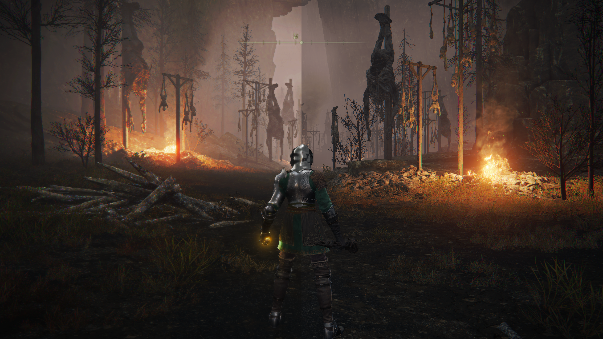
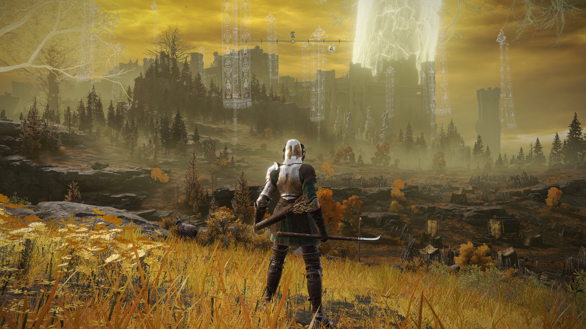
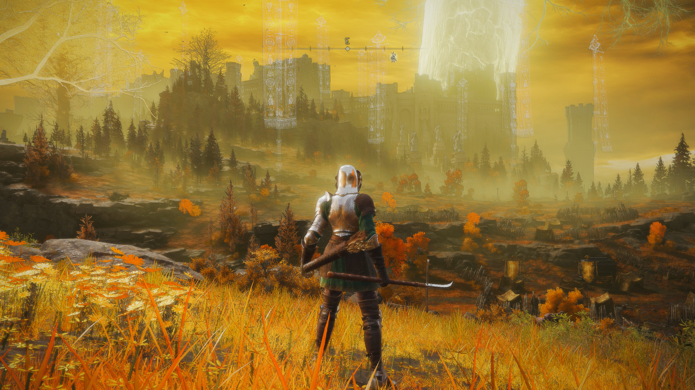
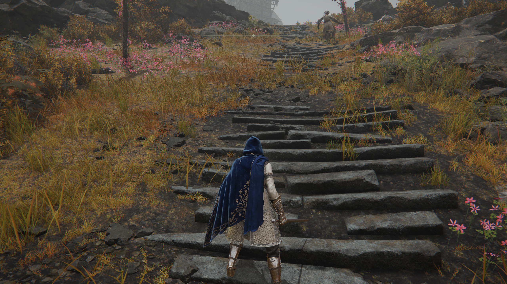
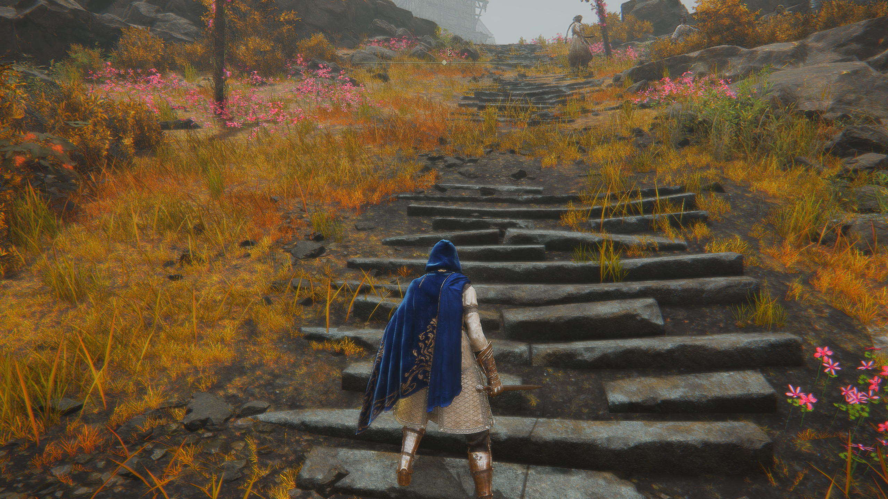
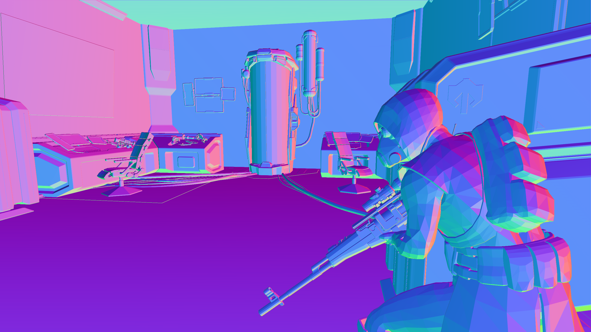

# Occult Box

Occult Box is a ReShade FX collection for image correction, stylized lighting,
depth diagnostics, screen-space shading, sampling experiments, and artistic
post-processing. The current tree contains **36 effects** organized into five
self-contained families.

Choose a family by the kind of image work you want to inspect, keep its effects
and headers together, and begin with a single technique. The catalog below
describes the supplied shader source; each effect still needs compile and
visual checks in the ReShade environment where it will be used.

<p align="center">
  
  <br>
  <sub><strong>Left:</strong> no effects — supplied Image 2 &nbsp;|&nbsp; <strong>Right:</strong> effects enabled — supplied Image 1</sub>
</p>

## Contents

- [Visual comparison](#visual-comparison)
- [Family guide](#family-guide)
- [Choosing an effect](#choosing-an-effect)
- [Complete effect catalog](#complete-effect-catalog)
- [ReShade and DisplayDepth credit](#reshade-and-displaydepth-credit)
- [Requirements and installation](#requirements)
- [Recommended first run](#recommended-first-run)
- [Repository layout](#repository-layout)
- [Validation and contribution](#validation-and-contribution)
- [License material](#license-material)

## Visual comparison

All four captures below are reproduced byte-for-byte from the supplied files.
No generated treatment, recompression, cropping, or other image editing was
applied while preparing this README.

### Castle comparison

<table>
  <tr>
    <th>Untouched — Image 1</th>
    <th>Effects enabled — Image 3</th>
  </tr>
  <tr>
    <td></td>
    <td></td>
  </tr>
</table>

### Stone-steps comparison

<table>
  <tr>
    <th>Untouched — Image 4</th>
    <th>Effects enabled — Image 2</th>
  </tr>
  <tr>
    <td></td>
    <td></td>
  </tr>
</table>

The screenshots demonstrate the supplied comparison set; they do not identify
an exact preset, effect order, or parameter configuration.

## Family guide

| Family | Effects | Headers | Focus |
|---|---:|---:|---|
| [`black_wand`](black_wand) | 21 | 80 | AA, AO, bloom, color, defringing, detail, denoising, hatch, lighting, and reflection-style treatments |
| [`book_of_death`](book_of_death) | 9 | 14 | Named multi-pass effects and reusable image-analysis servers |
| [`depth_oracle`](depth_oracle) | 1 | 22 | Depth, normal, confidence, fallback, and continuity diagnostics |
| [`golden_weave`](golden_weave) | 2 | 1 | Screen-space ray-marched indirect-light experiments |
| [`legacy_lenses`](legacy_lenses) | 3 | 9 | Standalone lens, hatch, sampling-layout, and mask inspection |

The published release deliberately excludes the development-only
`rm_library` and `rm_production` trees.

## Choosing an effect

This is a practical starting map, not a required preset order. Begin with the
smallest effect that addresses the problem you can actually observe.

| Goal | Start with | Move to when needed |
|---|---|---|
| Verify depth and normals | `black_wand_DepthOracle` | `BlackWand_MaskDepth_DebugRouter` for application masks and guard routing |
| Reduce edge crawl or shimmer | `BlackWand_SmartAA_EdgeClean` | `PottingClay` for a broader three-stage AA treatment; `BlackWand_SurfaceContinuity` for same-surface noise |
| Remove thin colored edge fringes | `BlackWand_EdgeChromaWard` | Inspect its color-family and correction-mask views, then tune only the affected hue bands |
| Add contact grounding | `BlackWand_DepthAO_ContactShade` | `DeathGaze` for contact, broad-form, and superfine AO layers |
| Add bloom | `BlackWand_ThreeBandBloom` | `BlackWand_BloomBurst_Corona` for a tighter core and broader corona treatment |
| Add indirect color or warm bounce | `BlackWand_GI_ColorBleed` or `BlackWand_MorningLight_GI` | `GoldenHour` or a `GoldenWeave` build for more involved screen-space gathering |
| Add reflection cues | `BlackWand_GlossSSR_MaterialSheen` | `BlackWand_ObsidianGlass_SSR` for dark surfaces; `FoolsGold` for layered reflection bands |
| Build a stylized ink or cel look | `BlackWand_HatchInkCel` | `BlackWand_LogSpiral_HatchClarity`, `CrookedTongue`, or `SpiritWorld` |
| Improve tone and color | `BlackWand_ToneDetail_Richness` | `BlackWand_DeepColor_Grade` or `BlueSmoke` for deeper local shaping |
| Inspect sampling or masks | `looking_glass` or `Kaleidoscope` | `ObsidianMirror`, `CrystalMass`, or `hexing_eye` for specialized fields |

## Complete effect catalog

The technique names below are the identifiers exposed to ReShade. Each linked
name opens the corresponding `.fx` source. “Declared passes” means render passes
declared in the current ReShade technique; it is separate from descriptive
terms such as “three-stage” or “three-layer.”

### Black Wand

Black Wand is the compact, task-oriented family. It contains 21 effects with
focused controls and debug views. Twenty effects declare a single ReShade pass;
Edge Chroma Ward declares three passes so it can correct, update its optional
history mask, and present the result. The family covers the short path from
cleanup and input diagnosis through shading, stylization, and final color work.

| Effect source | ReShade technique | What it does | Best fit |
|---|---|---|---|
| [01 — Smart AA: Edge Clean](black_wand/effects/BlackWand_01_SmartAA_EdgeClean.fx) | `BlackWand_SmartAA_EdgeClean` | Edge-aware anti-aliasing with a small-radius coherence cleanup and detail restoration. | Early cleanup for jagged edges, shimmer, and fine edge crawl. |
| [02 — Depth AO: Contact Shade](black_wand/effects/BlackWand_02_DepthAO_ContactShade.fx) | `BlackWand_DepthAO_ContactShade` | Uses the depth buffer for ambient occlusion and contact shading. | Grounding nearby surfaces after depth has been validated. |
| [03 — Three-Band Bloom](black_wand/effects/BlackWand_03_ThreeBandBloom.fx) | `BlackWand_ThreeBandBloom` | Separates bloom into a hot core, near halo, and wider corona with threshold and restraint controls. | Layered highlight glow without treating all brightness as one radius. |
| [04 — Hatch, Ink, Cel](black_wand/effects/BlackWand_04_HatchInkCel.fx) | `BlackWand_HatchInkCel` | Combines ink edges, cel-band tonal shaping, and a hatch overlay. | A compact illustrated or graphic treatment. |
| [05 — GI: Color Bleed](black_wand/effects/BlackWand_05_GI_ColorBleed.fx) | `BlackWand_GI_ColorBleed` | Approximates screen-space color bleed through a primitive sampling lens with depth rejection. | Gentle nearby-color transfer with a bounded control surface. |
| [06 — Gloss SSR: Material Sheen](black_wand/effects/BlackWand_06_GlossSSR_MaterialSheen.fx) | `BlackWand_GlossSSR_MaterialSheen` | Produces gloss, sheen, and short screen-space reflection-style cues. | Adding material response after depth setup is known-good. |
| [07 — Tone Detail: Richness](black_wand/effects/BlackWand_07_ToneDetail_Richness.fx) | `BlackWand_ToneDetail_Richness` | Shapes local tone, lifts shadows, compresses highlights, and restores detail. | A restrained finishing pass for image richness. |
| [08 — Raymarch: Primitive Light](black_wand/effects/BlackWand_08_RayMarch_PrimitiveLight.fx) | `BlackWand_RayMarch_PrimitiveLight` | Renders a procedural ray-marched primitive overlay with material color, normals, lighting, AO, and heat diagnostics. | Inspecting or presenting the local ray-march primitive path. |
| [09 — Mask and Depth Debug Router](black_wand/effects/BlackWand_09_MaskDepth_DebugRouter.fx) | `BlackWand_MaskDepth_DebugRouter` | Routes mask, depth-availability, fog/far, light-protection, and stable-surface diagnostics. | Understanding why a guarded effect applies—or does not apply—to a region. |
| [10 — Fog and Light Guard](black_wand/effects/BlackWand_10_FogLight_Guard.fx) | `BlackWand_FogLight_Guard` | Builds a protection mask for fog-like haze and bright light regions and exposes that mask for inspection. | Preventing later heavy filters from flattening haze or lights. |
| [11 — Far-Z Detail](black_wand/effects/BlackWand_11_FarZ_Detail.fx) | `BlackWand_FarZ_Detail` | Targets background and far-plane regions for local detail recovery with edge support. | Restoring distant readability without applying the same correction everywhere. |
| [12 — Micro Detail Clarity](black_wand/effects/BlackWand_12_MicroDetail_Clarity.fx) | `BlackWand_MicroDetail_Clarity` | Adds fine-scale clarity with edge protection. | Texture readability where aggressive sharpening would create halos. |
| [13 — Surface Continuity](black_wand/effects/BlackWand_13_SurfaceContinuity.fx) | `BlackWand_SurfaceContinuity` | Smooths same-surface incoherence while rejecting depth and image edges. | Shimmer or noisy surfaces that should remain separated at boundaries. |
| [14 — Bloom Burst and Corona](black_wand/effects/BlackWand_14_BloomBurst_Corona.fx) | `BlackWand_BloomBurst_Corona` | Builds highlight bloom from a tight core into a broad corona. | A more concentrated burst-and-corona response than the three-band variant. |
| [15 — Obsidian Glass SSR](black_wand/effects/BlackWand_15_ObsidianGlass_SSR.fx) | `BlackWand_ObsidianGlass_SSR` | Uses primitive reflection confidence, depth matching, and dark-surface targeting for a glass-like reflection cue. | Dark glossy materials and obsidian-style surfaces. |
| [16 — Log-Spiral Hatch Clarity](black_wand/effects/BlackWand_16_LogSpiral_HatchClarity.fx) | `BlackWand_LogSpiral_HatchClarity` | Applies a log-spiral hatch and ink treatment with edge and detail support. | Stylized texture that should remain legible around structure. |
| [17 — Guided Directional Tonal Shade](black_wand/effects/BlackWand_17_GuidedDirectional_TonalShade.fx) | `BlackWand_GuidedDirectional_TonalShade` | Derives directional tonal shading from depth and image gradients. | Guided relief and material-form readability. |
| [18 — Morning Light GI](black_wand/effects/BlackWand_18_MorningLight_GI.fx) | `BlackWand_MorningLight_GI` | Adds warm indirect light, shadow lift, and gentle color bleed through the primitive sampling lens. | A softer warm-bounce treatment. |
| [19 — Deep Color Grade](black_wand/effects/BlackWand_19_DeepColor_Grade.fx) | `BlackWand_DeepColor_Grade` | Combines shadow deepening, highlight protection, saturation, and warm/cool balance. | Final palette and tonal-weight adjustment. |
| [20 — Spiral Denoiser](black_wand/effects/BlackWand_20_SpiralDenoiser.fx) | `BlackWand_SpiralDenoiser` | Uses fixed spiral taps with edge protection and detail return; it does not rely on dynamic sample loops. | Bounded denoising where edges and small detail must survive. |
| [21 — Edge Chroma Ward](black_wand/effects/BlackWand_21_EdgeChromaWard.fx) | `BlackWand_EdgeChromaWard` | Detects narrow color outliers at luminance edges and corrects magenta, cyan, green, red, blue, and yellow fringes while preserving center-pixel luminance. | Image-driven cleanup with an optional, minute previous-mask guard for removal that is briefly occluded by slight motion. |

#### Edge Chroma Ward: image-driven use

`BlackWand_EdgeChromaWard` remains spatial by default. It does not require
depth or game motion vectors. Its optional **Minute Temporal Guard** stores the
previous source color and removal mask, then carries forward only a small,
rapidly decaying part of that mask when slight frame change occludes current
spatial detection. A small cross-shaped history search lets the mask follow a
minute pixel shift, while color matching rejects unrelated history. It does not
blend current and previous image color. Large frame changes reject the held
mask to limit trails and scene-change carryover.

The detector requires both a luminance edge and a narrow, locally exceptional
color band. Six controls cover the three opponent families visible in common
chromatic fringes: magenta/green, cyan/red, and blue/yellow. **Protect
Persistent Color** rejects broad color that continues into neighboring pixels,
reducing the chance that a real purple flower, green surface, or colored light
is mistaken for a one-pixel fringe.

Use **Detected Color Family** to identify the rim, **Thin Fringe Mask** to check
that the selected color is spatially narrow, and **Correction Amount** to see
the final gated application. When the optional guard is enabled, **Frame
Change** shows the current/previous difference and **Temporal Hold** shows only
the small amount of prior removal being retained. The split debug view places
the untouched source on the left and the corrected image on the right. A
practical starting order is to place the ward before strong clarity,
sharpening, saturation, or bloom passes that might enlarge an existing
game-rendered fringe. If one specific later effect creates a new rim, move the
ward immediately after that effect and retest the masks.

### Book of Death

Book of Death contains nine larger named effects. Some are final-look effects;
others are analysis servers that deliberately expose the sampling, pattern, or
mask fields used to construct later effects. Each current technique declares
one ReShade render pass, even where its internal design has several named
stages or layers.

| Effect source | ReShade technique | What it does | Best fit |
|---|---|---|---|
| [Blue Smoke](book_of_death/effects/BlueSmoke.fx) | `BlueSmoke` | Deepens local tone using organic support averaging, chroma-preserving luminance remapping, bounded lens support, and guarded application. | Organic deep-tone shaping that protects color identity. |
| [Crooked Tongue](book_of_death/effects/CrookedTongue.fx) | `CrookedTongue` | Displays and applies bio, multistage, log-spiral, clarity, stability, and cross-hatch fields with placement and shading masks. | Designing or applying procedural hatch systems. |
| [Crystal Mass](book_of_death/effects/CrystalMass.fx) | `CrystalMass` | Constructs masks from fog-like regions, highlights, depth ranges, contrast, hue, direction, silhouettes, and combined protection logic. | Mining and validating application or protection masks. |
| [Death Gaze](book_of_death/effects/DeathGaze.fx) | `DeathGaze` | Builds ambient occlusion from contact shadowing, broad grounding, and superfine crevice layers. | A more layered AO treatment than the compact Black Wand contact shade. |
| [Fools Gold](book_of_death/effects/FoolsGold.fx) | `FoolsGold` | Builds screen-space reflection cues from bright-highlight, general-base, and broad-gloss layers. | Layered reflective response across different material signals. |
| [Golden Hour](book_of_death/effects/GoldenHour.fx) | `GoldenHour` | Gathers nearby image color, filters it through sampling and application fields, and returns it as indirect bounce light. | Screen-space color recovery and indirect-light redistribution. |
| [Obsidian Mirror](book_of_death/effects/ObsidianMirror.fx) | `ObsidianMirror` | Displays and applies bounded Lens55, Fibonacci-derived, spiral, rectangular, diamond, ring, and square sampling fields. | Comparing lens placement, tap order, footprint, and coverage behavior. |
| [Potting Clay](book_of_death/effects/PottingClay.fx) | `PottingClay` | Combines FXAA-like directional smoothing, SMAA-like neighborhood blending, and organic lens-field adjunct smoothing behind an application mask. | A broader, highly inspectable anti-aliasing treatment. |
| [Spirit World](book_of_death/effects/SpiritWorld.fx) | `SpiritWorld` | Layers base banded shading, coarse hatch-driven shading, and superfine detail shaping without ray marching. | A full cel-shaded and hatched presentation. |

### Depth Oracle

| Effect source | ReShade technique | Declared passes | Role |
|---|---|---:|---|
| [Depth Oracle](depth_oracle/effects/black_wand_DepthOracle.fx) | `black_wand_DepthOracle` | 1 | A diagnostic harness for official ReShade depth and normals, manual preview decoding, continuity probes, confidence views, and explicitly bounded luma fallbacks. |

<p align="center">
  
  <br>
  <sub>Supplied Depth Oracle capture — color-encoded surface-normal diagnostic view.</sub>
</p>

Depth Oracle exposes its evidence in groups rather than hiding it behind one
final composite:

- **Input orientation and presence:** source image, UV gradient, checkerboard,
  raw depth, official linear depth, and depth-presence bars.
- **Decode comparison:** manual preview depth and normals, raw/manual/official
  comparison, endpoint masks, and difference heat.
- **Surface evidence:** official normals, normal relief, local depth detail,
  bands, edge confidence, and mid-coverage views.
- **Continuity probes:** horizontal and vertical shallow ray-march probes plus
  an official-depth continuity overlay.
- **Fallback diagnostics:** local luma contrast, surrogate depth, fallback AO,
  fallback activation, hybrid confidence, and the active missing-depth policy.

Official ReShade linear depth remains the reference branch. Manual decoding is
a live diagnostic preview, and luma-derived depth is explicitly a surrogate
fallback—not scene-truth depth.

### Golden Weave

Golden Weave contains two approaches to screen-space ray-marched indirect
lighting. Both expose final, indirect-only, contact-shadow, depth, normal,
sampling, guard, hit-weight, raw-bounce, fog-protection, and light-protection
views, plus draft through ultra quality presets and gather/ray-march/hybrid
modes.

| Effect source | ReShade technique | Declared passes | Design |
|---|---|---:|---|
| [RMGI Primitive](golden_weave/effects/GoldenWeave_RMGI_Primitive.fx) | `GoldenWeave_RMGI_Primitive` | 1 | Builds source, depth, color, lens, mask, ray-gather, guard, and diagnostic behavior from the local primitive header with explicit direction and step budgets. |
| [RMGI Redux](golden_weave/effects/GoldenWeave_RMGI_Redux.fx) | `GoldenWeave_RMGI_Redux` | 9 | A standalone implementation that splits the ray field into bounded render-target batches to avoid the HLSL X3511 loop-unroll failure associated with one large nested loop. |

These are screen-space approximations: they can only reason from buffers and
samples available to ReShade, not hidden geometry, off-screen surfaces, or the
game's original material and lighting data.

### Legacy Lenses

Legacy Lenses preserves three standalone analysis servers. Their value is
inspectability: each makes an intermediate field visible before that field is
used inside a more elaborate effect.

| Effect source | ReShade technique | What it exposes | Best fit |
|---|---|---|---|
| [hexing eye](legacy_lenses/effects/hexing_eye.fx) | `hexing_eye` | Hatch families, tonal and edge masks, detail controls, and depth-driven placement. | Evaluating hatch construction before committing it to a final shaded result. |
| [Kaleidoscope](legacy_lenses/effects/kaleidoscope.fx) | `kaleidoscope` | Sample masks, final masks, combination logic, and supporting color, depth, spatial, hatch, and protection diagnostics. | Building and comparing modular image masks. |
| [looking glass](legacy_lenses/effects/looking_glass.fx) | `looking_glass` | Tap layouts, true sampling footprints, reduced Fibonacci subsets, averaging, deltas, and spatial analysis masks. | Inspecting lens and sampling behavior independently of a final effect. |

## ReShade and DisplayDepth credit

Depth Oracle owes an explicit conceptual and diagnostic debt to
[ReShade](https://reshade.me/) and to
[`DisplayDepth.fx`](https://github.com/crosire/reshade-shaders/blob/slim/Shaders/DisplayDepth.fx),
created by CeeJay.dk and expanded over time by the ReShade community.
DisplayDepth provides an important reference for visualizing ReShade depth and
normal inputs and for diagnosing the configuration that makes those inputs
usable.

Depth Oracle was developed through **meta-meta analysis** of that diagnostic
work. The question was not *why did the upstream authors choose these
techniques?*—their private reasoning cannot be recovered from the shader alone.
Instead, the analysis asked:

- Which observable techniques were used, and what purpose did each serve?
- What could be learned from the information those techniques exposed?
- Which gaps, constraints, or failure modes remained?
- Which capabilities did those choices make possible?

Occult Box then accounted for those lessons and gaps while choosing its own
features and techniques for its own goals. The lessons functioned as design
constraints and warnings: they helped the project avoid known traps and blind
spots without treating upstream implementation choices as mandatory or
claiming knowledge of the upstream authors' intent. Depth Oracle is therefore
an independent implementation informed by analysis of established ReShade
diagnostic practice, not a copy of DisplayDepth's labels, prose, function
names, pass names, or code structure.

## Requirements

- A game or application supported by ReShade.
- A working ReShade installation with access to `ReShade.fxh`.
- A usable depth buffer for effects and diagnostic views that depend on depth.

Depth availability and orientation vary by game, graphics API, and ReShade
configuration. Color-only effects can still work when depth-based effects do
not, but each effect should be tested in the target application.

## Installation

1. Download or clone this repository.
2. Copy the `Occult Box` directory into a directory covered by ReShade's effect
   search path. A typical result is:

   ```text
   <game>/reshade-shaders/Shaders/Occult Box/
     black_wand/
     book_of_death/
     depth_oracle/
     golden_weave/
     legacy_lenses/
   ```

3. Preserve each family's `effects/` and `header/` directories. The effects use
   relative local includes and will not load correctly if the tree is flattened.
4. Ensure the copied directory is scanned recursively by ReShade.
5. Start the application, allow ReShade to compile the effects, and inspect its
   log before enabling several effects at once.

To install only selected families, copy the complete directory for each chosen
family. Do not copy an `effects/` directory without its matching `header/`
directory.

## Recommended first run

1. Enable `black_wand_DepthOracle` from `depth_oracle`.
2. Inspect its source, official depth, normal, confidence, and diagnostic views.
3. If depth-dependent views are invalid, correct the ReShade depth setup before
   tuning AO, GI, reflection, or depth-targeted effects.
4. Enable one additional technique at a time and begin with its final view at
   conservative strength.
5. Use the effect's mask or debug views to understand where it is applying
   before stacking it with other techniques.

For a lighter starting point, try `BlackWand_SmartAA_EdgeClean`,
`BlackWand_EdgeChromaWard`,
`BlackWand_ToneDetail_Richness`, or `BlackWand_DeepColor_Grade`. For experimental
indirect light, begin with `GoldenWeave_RMGI_Primitive` and increase its ray and
step budgets gradually.

## Repository layout

```text
Occult Box/
  black_wand/
    effects/        Loadable .fx techniques
    header/         Family-local .fxh dependencies
  book_of_death/
    effects/
    header/
  depth_oracle/
    effects/
    header/
  golden_weave/
    effects/
    header/
  legacy_lenses/
    effects/
    header/
  docs/images/      README comparison captures
```

## Validation and contribution

The repository contains 36 effect files and 126 headers. Those counts describe
the source tree, not a claim that every technique has passed a live runtime
test. The supplied captures illustrate particular comparisons; their exact
presets, effect order, and parameter settings are not reconstructed here.

For a change, start in the relevant family's `effects/` directory and follow
its includes into that family's `header/` directory. Keep source dependencies
and diagnostic views visible in review. A useful report identifies the effect,
the rendering API and ReShade version, the first compile error or warning, and
the observed result at a stated setting.

For visual changes, compare the input, diagnostic view, and final composite
before combining several treatments. Distinguish a depth reference from a
surrogate or diagnostic approximation, especially when working on Depth
Oracle. The family guide and catalog provide the starting points; the source
remains the place to inspect the actual processing path.

## License material

Existing copyright headers and upstream credits are preserved. Some effect
headers refer to `LICENSE-SOURCE-AVAILABLE-RESHADE-ONLY.txt`; that filename is
not bundled in this tree, and there is no standalone project-wide license file
here. This README records the supplied state without inventing replacement
terms or a new rights holder.
